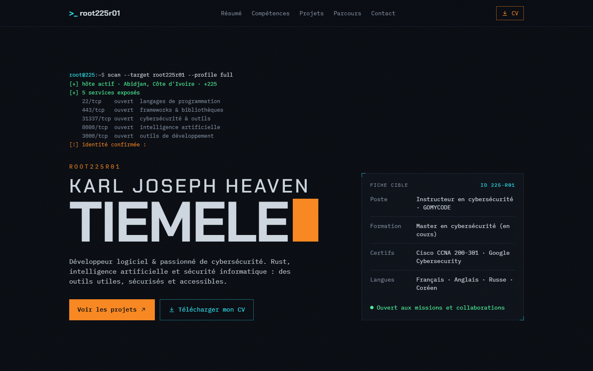
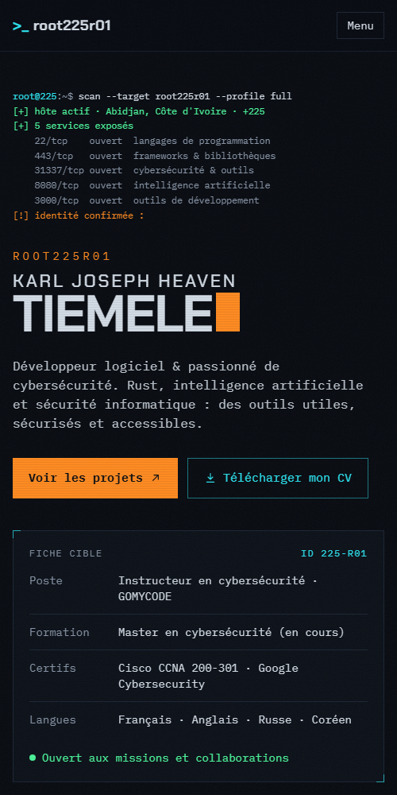

# root225r01 — Portfolio

[](https://github.com/root-225/root-225.github.io/actions/workflows/deploy.yml)
[](https://root-225.github.io/)


Portfolio de **Karl Joseph Heaven Tiemele** (alias `root225r01`), développeur logiciel et passionné de cybersécurité basé à Abidjan.
Direction artistique « Rapport d'audit 225 » : le site se lit comme un rapport de pentest, avec un scan d'ouverture, des modules de compétences et des fiches projets.

| Desktop | Mobile |
| --- | --- |
|  |  |

## Stack

- **Vite + React 19** : site statique, build rapide, aucun serveur.
- **Tailwind CSS 4** : tokens de couleur et de typo dans `src/index.css` (`@theme`).
- **Motion** : révélations au scroll, parallax léger du hero.
- **Canvas 2D** : grille radar en arrière-plan (~30 fps, désactivée si « mouvement réduit »).
- Polices auto-hébergées (Chakra Petch, IBM Plex Mono), aucun appel externe.

## Démarrer

```bash
npm install
npm run dev      # http://localhost:5173
npm run build    # génère dist/
```

## Modifier le contenu

Tout le contenu vit dans `src/data/`, sans toucher au code :

| Fichier | Contenu |
| --- | --- |
| `profile.json` | Nom, bio, email, liens réseaux (`socials[].url`), chemins du CV |
| `projects.json` | Projets affichés dans « Projets » |
| `skills.json` | Les 5 modules de compétences |
| `timeline.json` | Expériences, formations, certifications |

### Ajouter un projet

Ajoute un objet dans `src/data/projects.json` :

```json
{
  "id": "mon-app",
  "ref": "R225-005",
  "title": "Mon App",
  "category": "Application",
  "status": "prod",
  "summary": "Ce que fait l'app, en une phrase.",
  "stack": ["Rust", "React"],
  "image": "/projects/mon-app.webp",
  "links": [
    { "label": "Disponible sur Google Play", "url": "https://play.google.com/store/apps/details?id=...", "kind": "playstore" },
    { "label": "Dépôt GitHub", "url": "https://github.com/root-225/mon-app", "kind": "github" }
  ]
}
```

- `status` : `live` (badge Live), `wip` (Work in progress) ou `prod` (In Production).
- `image` : dépose la capture dans `public/projects/` (WebP 1280×720 conseillé). `null` affiche le placeholder.
- `kind` : `playstore`, `github`, `doc` ou autre. Un lien avec `"url": ""` s'affiche grisé (« bientôt »).

### Réseaux sociaux

Renseigne `url` dans `profile.json > socials`. Une icône sans URL reste visible mais grisée (« lien à venir »).

## CV

- Version web : `public/cv/index.html` (servie sur `/cv/`).
- PDF : `public/cv/CV_Karl_Tiemele.pdf`, régénéré depuis la version web avec Chrome :

```bash
npm run dev
"C:\Program Files\Google\Chrome\Application\chrome.exe" --headless=new --no-pdf-header-footer --print-to-pdf="public\cv\CV_Karl_Tiemele.pdf" http://localhost:5173/cv/index.html
```

## Déploiement

Chaque push sur `main` lance `.github/workflows/deploy.yml` : build Vite puis publication sur GitHub Pages
(Settings → Pages → Source : **GitHub Actions**).

La page `public/lettreking/confidentialite.html` (politique de confidentialité de LettreKing) est conservée à la même adresse :
`https://root-225.github.io/lettreking/confidentialite.html`.

## Contact

[root225r01@gmail.com](mailto:root225r01@gmail.com) · [github.com/root-225](https://github.com/root-225)
